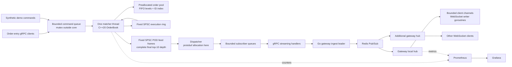

# PulseFeed

**Distributed Low-Latency Market Data & Order Book Engine**

PulseFeed is a C++20 price-time priority matching core with a Go streaming gateway, gRPC transport, Redis fan-out, WebSocket subscribers, and Prometheus/Grafana observability. It is a runnable systems reference for studying bounded memory, deterministic matching, concurrency, latency measurement, and distributed failure modes.

The core allocates its storage during construction. Order insertion, cancellation, matching, trade publication into its SPSC ring, and bounded depth snapshots perform no dynamic allocation. Network transport, protobuf encoding, command admission, and gateway fan-out run outside that boundary and may allocate or block.

This repository is production-oriented reference software, not a complete exchange. State is in memory; there is no journal, replication, durable execution delivery, exchange session protocol, or recovery of orders after an engine restart. Redis Pub/Sub and WebSockets carry best-effort market data. Do not treat an accepted RPC or a displayed trade as a durable settlement record.

## Start here

Use the dependency-free core first, then the distributed stack. No benchmark result is claimed in this README: measure on your own hardware and retain the raw output.

```bash
make test-core

cmake -S . -B build -DCMAKE_BUILD_TYPE=Release
cmake --build build -j
ctest --test-dir build --output-on-failure
```

The core compiles with `g++ -std=c++20`; gRPC, protobuf, Redis, and Google Benchmark are optional dependencies of the surrounding executables, not of `OrderBook.cpp`.

For the full stack, install Docker Engine and the Compose plugin, then run:

```bash
docker compose up --build -d
docker compose ps
docker compose logs -f engine gateway
```

If the default host ports are already in use, choose alternatives before starting the stack:

```bash
export GATEWAY_PORT=18080 PROMETHEUS_PORT=19090 GRAFANA_PORT=13000
docker compose up --build -d
```

These variables change host ports only. Use the same environment for `scripts/smoke.sh`, and adjust client URLs accordingly, for example `ws://localhost:18080/ws`.

The engine's demo generator is enabled by default in Compose. It produces synthetic commands for one instrument; no exchange credentials or live market feed are involved.

| Service | Local endpoint | Purpose |
| --- | --- | --- |
| Gateway | `http://localhost:8080` | HTTP status, metrics, and `/ws` |
| WebSocket | `ws://localhost:8080/ws` | Complete top-10 depth plus optional trade |
| Engine | Compose network, `engine:50051` | Internal gRPC `MarketData` service |
| Engine metrics | Compose network, `http://engine:9091/metrics` | Matcher and publication counters |
| Prometheus | `http://localhost:9090` | Metrics queries and scrape status |
| Grafana | `http://localhost:3000` | Provisioned PulseFeed dashboard |
| Redis | Compose network, `redis:6379` | Internal Pub/Sub transport |

Only the gateway, Prometheus, and Grafana ports are published, bound to host loopback. Sign in to Grafana as `admin` / `pulsefeed-local`; override `GRAFANA_USER` and `GRAFANA_PASSWORD` for your deployment. The dashboard is provisioned under the title **PulseFeed — Market Data Pipeline**.

After Compose is running, use a supported patched Go toolchain to build/test the gateway and run simulated clients. The source minimum is Go 1.26.0; use **Go 1.26.10 or later within the 1.26 series, or Go 1.27.3 or later** for the security fixes listed in the official [Go release history](https://go.dev/doc/devel/release). The gateway Docker build pins Go 1.27.3.

```bash
cd gateway
go test -race ./...
go build ./...
go run ./cmd/subscriber -url ws://localhost:8080/ws -clients 10 -duration 10s
```

`./scripts/smoke.sh` builds/starts the stack, waits for gateway, Prometheus, and Grafana readiness, and checks 20 concurrent subscribers. It requires Docker Compose and `curl`, exits nonzero on failure, and leaves services running for inspection. Gateway readiness requires a valid full depth event received from Redis and cached locally, so an admitted WebSocket has an initial snapshot available.

Shut down with `docker compose down`. Add `-v` only when you intend to delete the observability volumes.

To package just the repository's project sources, run `./scripts/package.sh /tmp/PulseFeed-source.tar.gz`. The script selects the project paths explicitly and excludes build artifacts and unrelated workspace metadata.

### Verification performed

This implementation was verified on 5 November 2026 with GCC 13 in Ubuntu 24.04 containers, GCC 16 for the standalone core, and the gateway's pinned Go 1.27.3 container toolchain:

- Core tests passed 60,000 commands against an independent reference model, one million cross-thread SPSC messages, and explicit FIFO, partial-fill, price-boundary, pool-full, and feed-full cases.
- Allocation tests observed zero C++ and wrapped C allocations over 20,000 insertion, matching, cancellation, and snapshot cycles. AddressSanitizer and UndefinedBehaviorSanitizer passed both core test executables. Valgrind reported zero errors and no leaks for the core correctness suite, including its allocating reference model.
- All 26 benchmark cases compiled and ran, producing ordered p50/p95/p99 counters. The shared verification host had CPU scaling and other workloads active; its timings are execution checks, not a hardware performance commitment.
- Seven Go race tests passed, including an in-process gRPC/Redis/WebSocket pipeline and Redis restart recovery. The official `govulncheck` v1.9.0 binary scan of the final gateway reported no vulnerabilities found; rerun scans as advisories change.
- Real Go-to-C++ RPC checks passed submission, partial execution, duplicate rejection, cancellation, and full matching. Twenty concurrent clients received 5,880 feed events in three seconds with no missing sequences, reconnects, or failures in that run.
- All five services started. Prometheus reported every configured target up, and Grafana provisioned the PulseFeed dashboard. Restarting Redis caused detectable sequence gaps, followed by automatic subscription and depth recovery.

These checks establish observed behavior for the included workloads. They do not establish a trading-venue latency SLA, durable execution delivery, or fault-tolerant order recovery.

## Repository map

| Path | Responsibility |
| --- | --- |
| `OrderBook.hpp`, `OrderBook.cpp`, `SpscRing.hpp` | Bounded L3 order storage, L2 aggregation, matching, SPSC |
| `benchmarks.cpp` | Google Benchmark throughput and sampled latency/cycle harness |
| `tests/` | Matching, invariants, randomized reference checks, allocation and ring checks |
| `cpp/engine.cpp` | gRPC adapter, command admission, matcher, dispatcher, metrics |
| `proto/pulsefeed.proto` | Shared streaming and command contract |
| `gateway/main.go` | Go gRPC ingestion, Redis publication/subscription, WebSocket fan-out |
| `gateway/gen/` | Checked-in generated protobuf and gRPC Go sources |
| `gateway/cmd/subscriber/` | Concurrent simulated WebSocket subscribers |
| `gateway/cmd/order/` | gRPC order submission and cancellation client |
| `CMakeLists.txt`, `Makefile` | Core, test, engine, and benchmark builds |
| `docker-compose.yml`, Dockerfiles | Reproducible service orchestration |
| `observability/` | Prometheus and Grafana provisioning |
| `.github/workflows/` | Automated build and verification |
| `scripts/` | Protocol generation, full-stack smoke check, and source archive packaging |

## Architecture and thread ownership



An ownership rule is more useful than a blanket claim that the system is lock-free:

1. Only the matcher thread mutates the live `OrderBook`, reads snapshots, and checks its invariants. Its trade-ring consumer is the one exception: one designated consumer may call `try_pop_trade` concurrently. The engine chooses to drain that ring on the matcher thread itself. Other concurrent external calls are unsafe.
2. RPC handlers submit to a bounded command queue. A mutex and condition variable are appropriate here because this stage is outside the matching core and receives many producers.
3. The core's trade ring has exactly one producer and one consumer. The engine drains it on the matcher thread after each command; the separate output SPSC transfers immutable feed frames to the dispatcher thread.
4. The dispatcher serializes protobuf events and sends them to bounded per-subscriber queues. A slow gRPC writer cannot stop the matcher from progressing.
5. One gateway ingests the engine stream and publishes to Redis. All gateways, including that publisher, subscribe to Redis and broadcast to their own local clients.
6. Each WebSocket has a single writer goroutine. The hub owns membership and closes slow consumers when their finite channel fills.

Matching order is the order in which the matcher dequeues commands. Concurrent clients have no universal wall-clock ordering. TCP order on one connection, arrival at a handler, queue admission, and matching are distinct boundaries.

## Matching semantics

The engine implements one synthetic instrument with integer tick prices and integer lot quantities. The default supported price lattice is **1 through 20,000 inclusive**, with **65,536 simultaneously active orders**. Integer arithmetic avoids floating-point price equality and rounding ambiguity; real venues also require instrument metadata, decimal display rules, lot size, and price bands.

An order has a nonzero ID, side, limit price, and positive quantity. IDs must be unique among active orders. An ID becomes reusable after its previous order fills or is cancelled; this is not an idempotency guarantee across sessions or time.

- A buy crosses the cheapest ask while `ask_price <= buy_limit`.
- A sell crosses the highest bid while `bid_price >= sell_limit`.
- Better prices execute first. At the same price, makers execute in insertion order.
- Each execution uses the resting maker's price, not the aggressor's limit.
- A partially filled maker keeps its queue position. An unfilled incoming remainder joins the tail of its own price level.
- Cancellation removes the active order's entire remaining quantity. Cancelling an unknown ID returns a rejection without changing the book.
- A resting buy and sell cannot remain crossed after a successful command.

Example:

```text
Submit sell A: price 101, quantity 5
Submit sell B: price 101, quantity 7
Submit sell C: price 102, quantity 4
Submit buy  D: price 102, quantity 9

Execution 1: A -> D, 5 @ 101
Execution 2: B -> D, 4 @ 101
Remaining: B sells 3 @ 101; C sells 4 @ 102
```

A single incoming order can generate many executions. A trade means a maker/taker match, not an aggregated price-level fill.

There are no market orders, amendments, IOC/FOK, stop orders, auctions, hidden liquidity, self-trade prevention, risk limits, or multi-instrument routing. A cancel followed by a new order receives new time priority. Introducing an amendment API requires an explicit policy for which changes preserve priority.

### Atomic rejection and bounded resources

Before matching, the core validates the incoming order and checks the fixed node pool and required execution-ring capacity. It walks the eligible makers to count the executions that would occur. If the entire operation cannot fit, it rejects before mutating any order or aggregate.

This makes a ring-full rejection predictable: no partial fills have secretly occurred. The default trade ring has 8,192 usable records, so a command requiring more than 8,192 maker executions is rejected even when the ring starts empty. The preflight pass costs an additional traversal of the matching makers. The pool check is deliberately conservative: a full active-order pool rejects a submission even if that order would have executed completely and needed no resting node.

Cancels do not generate executions. Invalid input, duplicate active IDs, missing cancels, exhausted nodes, and insufficient trade-ring space have explicit result codes. Capacity exhaustion is a normal operational outcome, not an excuse to allocate on the hot path.

The surrounding feed pipeline has a different policy: it may drop market-data frames to protect matching progress. An accepted command can therefore be absent from a particular subscriber's feed. The RPC command result describes matching admission and completion, not durable market-data delivery.

## Core data structures and cost model

### Contiguous pool and intrusive FIFO levels

The order pool is a flat vector sized at construction. Each slot stores an order and integer links; a free list recycles slots without object allocation. Price levels hold FIFO head/tail indices and aggregate quantity/count. Removing a known node changes its neighboring links and level totals. Integer indices avoid allocator metadata and keep the pool relocatable as a whole during construction; the pool is never resized after publication.

Each price has a direct level entry. A bitmap marks occupied prices. Word scans and `std::countr_zero` / `std::countl_zero` locate occupied levels instead of visiting every empty tick. The bounded lattice trades memory for simple addressing. A large, sparse or unbounded instrument universe would call for a different price index.

Active order IDs use a fixed flat open-addressed table. Backward-shift deletion repairs probe chains, avoiding a growing collection of tombstones. Hash lookup is expected constant time at a controlled load factor, but collisions and deletion clusters have finite linear worst cases. This design does not claim collision-proof constant-time cancellation.

| Operation | Main work |
| --- | --- |
| Resting insert | Validate, ID lookup, pool pop, append to FIFO, update aggregate and bitmap |
| Cancel | ID lookup, unlink node, erase hash entry, recycle slot, update aggregate |
| Match with `K` makers | Preflight maker traversal, then `K` executions, removals and bitmap scans |
| Best price | Bitmap scan over a finite price lattice |
| Top-10 snapshot | Walk occupied levels until ten entries per side or the book is exhausted |
| SPSC `try_push` / `try_pop` | Fixed number of atomic loads/stores and a POD copy |

None of these statements makes an unlimited market sweep constant time. A sweep over `K` makers must emit and process `K` executions, and an ID-table collision cluster can be expensive. Bounded memory and bounded input domains make the maximum workload explicit; they do not make every command equally cheap.

### Allocation boundary

Construction allocates the node pool, price arrays, bitmap words, ID table, and fixed rings. Steady-state methods use those existing capacities. They do not use `std::map`, dynamically growing `std::unordered_map`, `std::list`, strings, protobuf objects, logging streams, or heap-backed callbacks.

The no-allocation contract applies to the core methods after construction, not the process. C++ gRPC, Go garbage collection, Redis messages, HTTP, metrics formatting, benchmark sample storage, and test reference structures can allocate. Tests count C++ `operator new` calls around warmed core operations. Linux builds also use GNU linker wrapping for direct `malloc`, `calloc`, `realloc`, and `aligned_alloc` calls from the core object. These hooks do not intercept allocation inside arbitrary shared-library internals, so source inspection and allocator-level profiling remain necessary when changing that boundary; a clean Valgrind leak report alone cannot prove zero allocations.

Preallocation removes allocator contention and growth pauses, but not first-touch page faults, scheduler interrupts, TLB misses, CPU frequency changes, or cache misses. For stricter deployments, fault in memory on the intended NUMA node before admitting traffic, evaluate memory locking and huge pages, and verify the result under the actual security and resource limits. These are deployment choices, not promises made by `reserve()` or `alignas`.

### Why 64-byte alignment helps, and where it does not

Critical nodes and ring cursor structures use `alignas(64)`. Separating independently written producer/consumer cursors prevents those counters from accidentally sharing a typical 64-byte cache line. A coherence protocol tracks ownership at cache-line granularity: different threads writing unrelated bytes in one line can repeatedly invalidate one another's copies. Intel documents this false-sharing cost in its [optimization reference manual](https://cdrdv2-public.intel.com/821612/248966-Optimization-Reference-Manual-V1-050.pdf).

The payload transfer is true sharing: the consumer must eventually read data the producer wrote. Padding cannot remove that required communication. Nor does padding make random order IDs cache-local. A single-writer book already avoids concurrent writes to order nodes; aligning nodes offers a stable layout, but can waste capacity compared with tightly packed nodes. Measure the density/alignment tradeoff rather than assuming every aligned structure is faster.

A cache miss can stall a dependent load chain. Linked structures amplify this because the next address is unavailable until the current node arrives. Rare LLC misses, remote NUMA accesses, or page faults can dominate p99 while barely changing the median. Flat storage improves locality and predictability; it does not ensure that a multi-megabyte book fits in L1. Cache-line size is an architectural property: re-evaluate 64 bytes on other targets, especially those with larger destructive-interference granularity.

## SPSC memory ordering, explained from both directions

The ring is finite and never overwrites unread payloads. The cursor atomic type is required to be always lock-free on the build target. Each `try_*` operation either succeeds or immediately reports full/empty; there is no compare-exchange retry loop, allocation, or mutex inside the ring.

A simplified publication sequence is:

```cpp
// Producer only:
const auto head = producer_head.load(std::memory_order_relaxed);
const auto tail = consumer_tail.load(std::memory_order_acquire);
if (head - tail == capacity) return false;
slots[head & mask] = value;
producer_head.store(head + 1, std::memory_order_release);

// Consumer only:
const auto tail = consumer_tail.load(std::memory_order_relaxed);
const auto head = producer_head.load(std::memory_order_acquire);
if (head == tail) return false;
value = slots[tail & mask];
consumer_tail.store(tail + 1, std::memory_order_release);
```

This illustrates ordering; use the actual class for its capacity convention, types, and validation.

There are two happens-before relationships:

1. Producer payload writes occur before the release of `head`. A consumer acquire observing that publication makes those writes visible before reading the slot.
2. Consumer payload reads occur before the release of `tail`. A producer acquire observing that release establishes that reuse will not race with the prior read.

The thread's own cursor can be loaded relaxed because it is the only writer. Loading the other cursor relaxed would remove the portable synchronization proof even if a particular x86 build appeared to work. Acquire/release constrain compiler and hardware reordering; they are not synonymous with flushing all CPU caches. The C++20 [draft standard, atomics ordering section](https://isocpp.org/files/papers/N4860.pdf) defines this synchronization contract.

`volatile` provides neither atomicity nor inter-thread happens-before. Sequential consistency is a valid conservative starting point, but a total order across all atomics is unnecessary for this ownership protocol. On some CPUs acquire/release needs distinct instructions; on x86 it may compile to ordinary loads/stores with compiler ordering constraints. Correctness must follow the language memory model, not one assembly listing.

The fixed-step SPSC operations have a bounded algorithmic path under the stated single-producer/single-consumer ownership and lock-free atomic assumption. That does not make end-to-end matching wait-free: the OS can preempt either thread, matching work varies with maker count, and the network pipeline contains locks and blocking I/O. Adding a second producer invalidates this ring's correctness; use a separate MPSC admission structure or one SPSC per producer with a defined merge order.

## Wire protocol and subscriber consistency

`proto/pulsefeed.proto` defines:

```text
MarketData.Subscribe(SubscribeRequest) -> stream FeedEvent
MarketData.Submit(OrderRequest)        -> CommandReply
MarketData.Cancel(CancelRequest)       -> CommandReply
```

Prices are ticks, quantities are lots, aggregate level quantity is 64-bit, and order IDs are 64-bit. Side `0` is unspecified and invalid for order submission. `CommandReply` reports acceptance, a reason, and the latest assigned feed sequence at command completion; it is not a durable commit offset or an order identifier. A command producing several trades returns the last sequence assigned to those frames. Rejections do not create command feed events. A unary timeout does not prove that the command was never matched.

Every `FeedEvent` includes an engine `epoch`, monotonic feed `sequence`, wall-clock `unix_nanos`, complete top-10 `bids` and `asks`, and an optional `trade`. A snapshot marker identifies a snapshot-only publication. Bid levels are best first, as are ask levels. Empty repeated arrays mean no visible levels on that side.

The gateway emits canonical protobuf JSON with lower-camel-case field names and explicit defaults. Protobuf `uint64` fields are JSON **strings** to preserve precision in JavaScript. A snapshot looks like:

```json
{
  "epoch": "engine-session-id",
  "sequence": "12",
  "unixNanos": "1793872800000000000",
  "trade": null,
  "bids": [{"price": 100, "quantity": "25", "orders": 2}],
  "asks": [{"price": 101, "quantity": "10", "orders": 1}],
  "snapshot": true
}
```

A trade object contains `makerOrderId` and `takerOrderId` as strings, numeric `price`/`quantity`, and `aggressorSide` as `"BUY"` or `"SELL"`. A newly connected WebSocket receives the gateway's cached depth snapshot with `trade: null`; it does not receive a historical execution twice.

A command generating several trades creates several feed events. All those events contain the **final post-command book**. They do not reconstruct the intermediate book after each individual fill. This simplifies the bounded snapshot boundary, and means consumers must not apply the trade to that included depth again.

On subscribe, the engine returns its cached latest full depth as a snapshot without replaying the cached trade. Before the first event this can be an empty book at sequence zero. After one second with the command queue idle, the matcher publishes a full snapshot heartbeat with no trade. It advances the feed sequence without increasing the command counter, helping new Redis followers and reconnected gateways obtain depth even when no orders change. Sequence numbers are assigned before publication attempts, so a dropped frame leaves a detectable gap. A new engine process creates a new epoch; sequence comparison across epochs has no meaning.

Recommended subscriber logic:

```text
new epoch: discard old session state; replace depth from this event
same epoch, increasing sequence: replace depth from this event
same epoch, sequence jump: record loss; replace depth from this event
same epoch, duplicate or older sequence: ignore for normal live updates
snapshot on reconnect: use it to establish current depth, not trade replay
```

A complete snapshot repairs the visible top ten at the next successfully received event. It cannot repair missing trades, reconstruct deeper levels, or recover an execution ledger. A new snapshot is not evidence that the stream was gap-free. Depth recovery still requires another frame to traverse the entire live path: an idle heartbeat, future command update, or reconnect snapshot. A partition can prevent all three, so consumers need an independent staleness timeout.

Redis Pub/Sub has at-most-once delivery and no history: a disconnected subscriber cannot request missed messages. This is an explicit [Redis delivery contract](https://redis.io/docs/latest/develop/use-cases/pub-sub/). A durable product requires a journal or replayable log plus a snapshot/replay handshake, not merely a larger channel.

### Backpressure policy by boundary

| Boundary | Behavior under pressure | Consequence |
| --- | --- | --- |
| RPC -> command queue | Bounded admission / rejection | Caller handles overload |
| Core -> trade ring | Preflight rejection before mutation | No partial command on capacity failure |
| Matcher -> dispatcher | Finite SPSC, drop feed frame when full | Matching continues; sequence gaps expose loss |
| Dispatcher -> gRPC subscriber | Bounded subscriber queue; disconnect slow reader | One reader cannot retain unbounded history |
| Gateway -> Redis | Bounded network waits; reconnect/retry stream as configured | Feed continuity is not guaranteed |
| Redis -> gateway | Pub/Sub reconnect | Offline interval is unrecoverable |
| Hub -> WebSocket | Bounded client queue; evict slow consumer | Fast readers keep progressing |

A streaming transport's own flow control can delay writes; gRPC explains its mechanism in the [flow-control guide](https://grpc.io/docs/guides/flow-control/). Application queue limits remain necessary because transport flow control does not define a market-data loss policy.

Only one gateway should publish a particular engine stream to the shared channel. Additional gateways run with ingestion disabled. Running several independent ingest publishers creates duplicate traffic; there is no distributed leader election or fenced lease in this repository.

## Local builds and development

### Core only

```bash
make test-core
```

The dependency-free path is useful for interviews and compiler exploration. Read `OrderBook.hpp`, then `OrderBook.cpp`, then the tests. Keep correctness checks enabled while changing data structures; benchmark only optimized builds.

### Engine and Google Benchmark

On Debian/Ubuntu, the following are the relevant development packages:

```bash
sudo apt-get update
sudo apt-get install -y build-essential cmake pkg-config \
  libgrpc++-dev libprotobuf-dev protobuf-compiler protobuf-compiler-grpc \
  libbenchmark-dev

cmake -S . -B build-full -DCMAKE_BUILD_TYPE=Release \
  -DPULSEFEED_BUILD_ENGINE=ON -DPULSEFEED_BUILD_BENCHMARKS=ON
cmake --build build-full -j
ctest --test-dir build-full --output-on-failure
```

CMake generates C++ protocol sources in the build directory. Generated Go sources are checked in so `go build` does not require a local protoc installation. The proto is the source of truth; regenerate both sides when its contract changes. `make proto` runs `scripts/generate-go.sh` for Go stubs; the C++ generation is part of the engine build.

### Engine without Compose

```bash
ENGINE_ADDR=0.0.0.0:50051 ENGINE_METRICS_PORT=9091 \
ENGINE_DEMO=true DEMO_INTERVAL_US=10000 ./build-full/engine
```

`ENGINE_DEMO=false` disables synthetic order generation for external gRPC command clients. `--healthcheck` is available for the container health check. `ENGINE_TOKEN` enables bearer-token checking on the gRPC service. Certificate and key environment variables enable TLS; `ENGINE_TLS_CLIENT_CA_FILE` additionally requires client certificates. Keep credentials in deployment secrets, not source-controlled Compose files.

### Submit and cancel your own orders

Run a native engine with `ENGINE_DEMO=false` for a clean book. The included Go CLI supports deadlines, TLS, token metadata, and explicit nonzero order IDs:

```bash
cd gateway
go run ./cmd/order -addr localhost:50051 -id 1001 -side sell -price 101 -qty 5
go run ./cmd/order -addr localhost:50051 -id 1002 -side buy -price 101 -qty 3
go run ./cmd/order -addr localhost:50051 -id 1001 -cancel
```

The buy executes 3 lots at 101; the cancel removes the remaining 2. The default command deadline is 3 seconds (`-timeout`). Rejections and RPC failures exit with a nonzero status; the JSON reply includes `accepted`, `reason`, and a string-valued `sequence`. TLS flags are `-tls`, `-ca`, `-server-name`, and `-token`; CA/server name/token settings require TLS. The `ENGINE_*` environment variables provide the same client defaults as the gateway.

For a Compose engine, the packaged CLI can run inside the gateway container without publishing the gRPC port. With a clean `ENGINE_DEMO=false` engine, the equivalent first submission is:

```bash
docker compose exec -T gateway order -addr engine:50051 \
  -id 1001 -side sell -price 101 -qty 5
```

To use host clients with Compose instead, publish its port explicitly in a local Compose override:

```yaml
services:
  engine:
    ports:
      - "127.0.0.1:50051:50051"
```

Start that stack with `ENGINE_DEMO=false docker compose -f docker-compose.yml -f compose.local.yml up --build -d` after saving the override as `compose.local.yml`. For an optional raw protocol inspection from the repository root, [grpcurl](https://github.com/fullstorydev/grpcurl#invoking-rpcs) can subscribe without server reflection by loading the supplied proto:

```bash
grpcurl -plaintext -import-path proto -proto pulsefeed.proto -d '{}' \
  localhost:50051 pulsefeed.v1.MarketData/Subscribe
```

Use the appropriate CA/server-name flags and authorization metadata for TLS endpoints instead of `-plaintext`.

### Configuration

All capacities are finite. Core `BookConfig` is construction-time configuration; engine queue limits are compile-time constants. The gateway validates environment inputs at startup.

| Engine variable | Default | Meaning |
| --- | --- | --- |
| `ENGINE_ADDR` | `0.0.0.0:50051` | gRPC listen address |
| `ENGINE_METRICS_PORT` | `9091` | Minimal `/metrics` and `/health` HTTP server |
| `ENGINE_DEMO` | `true` | Synthetic order producer |
| `DEMO_INTERVAL_US` | `10000` | Synthetic command interval in microseconds |
| `ENGINE_TOKEN` | unset | Require `authorization: Bearer ...` on gRPC |
| `ENGINE_TLS_CERT_FILE`, `ENGINE_TLS_KEY_FILE` | unset | PEM server certificate/key, required together |
| `ENGINE_TLS_CLIENT_CA_FILE` | unset | Require a client certificate from this CA |

The engine ingress queue has 4,096 commands, the core execution ring and matcher-to-dispatcher ring each have 8,192 usable slots, and each gRPC subscriber has a 256-event queue. At most 256 gRPC subscribers are admitted. These limits protect different resources; increasing one does not increase the others.

| Gateway variable | Default | Meaning |
| --- | --- | --- |
| `HTTP_ADDR` | `:8080` | HTTP and WebSocket listen address |
| `ENGINE_ADDR` | `engine:50051` | gRPC dial target; use `localhost:50051` for native development |
| `REDIS_ADDR` | `redis:6379` | Redis address; use `localhost:6379` for native development |
| `REDIS_URL` | unset | Optional `redis://` / `rediss://` URL, overrides address |
| `REDIS_CHANNEL` | `pulsefeed.events` | Shared binary protobuf Pub/Sub channel |
| `INGEST` | `true` | Bridge engine stream to Redis; false on fan-out-only replicas |
| `MAX_CLIENTS` | `2000` | Maximum local WebSocket subscribers |
| `CLIENT_BUFFER` | `64` | Events buffered per client, allowed range 1–4,096 |
| `AUTH_TOKEN` | unset | Require a Bearer header on `/ws` |
| `ALLOWED_ORIGINS` | unset | Comma-separated exact browser origins; unset requires same Host |
| `ENGINE_TLS` | `false` | Enable gRPC TLS |
| `ENGINE_CA_FILE` | unset | Optional custom engine CA PEM |
| `ENGINE_SERVER_NAME` | unset | Optional TLS server-name override |
| `ENGINE_TOKEN` | unset | Engine Bearer token; gateway requires TLS for this setting |

The gateway also requires TLS when a custom engine CA or server-name override is configured. It does not provide a client-certificate setting, so an engine requiring mutual TLS needs another configured client or a gateway extension. Origin-less CLI clients are accepted; `AUTH_TOKEN` is the optional access check. The subscriber accepts `-token` for authenticated connections and `-quiet` to reduce event output.

`/healthz` reports process liveness; `/readyz` checks dependency state. A fan-out-only gateway does not require its own engine stream to be ready. A healthy process is not evidence that market data is fresh; consumers should separately track the last received epoch/sequence and timestamp.

## Measuring latency without misleading yourself

### Google Benchmark runs

Build the benchmark target as above, then run it on an allowed dedicated CPU:

```bash
PULSEFEED_CPU=2 ./build-full/benchmarks \
  --benchmark_repetitions=5 \
  --benchmark_out=benchmark-results.json --benchmark_out_format=json
```

Check `taskset -pc $$` or `lscpu -e` before choosing a CPU: containers and CI runners may restrict the affinity mask. Affinity binds the benchmark thread; it does not reserve a core, disable interrupts, move unrelated workloads, or isolate an SMT sibling. Run on a quiet physical core for interpretable comparisons and record governor, turbo policy, CPU topology, kernel, compiler flags, and book occupancy.

The suite separates bulk Google Benchmark timing from a per-operation sampling harness. Workloads are `Latency/{Empty,Insert,Cancel,Match,Sweep8,Duplicate}` and corresponding `Cycles/` cases, each with `/0` and `/60000` background-order populations, plus `Throughput/InsertCancel` and `Throughput/MatchAndDrain`. Background orders rest outside the measured crossing range. The 60,000-order case exercises a book near its configured order capacity and roughly 46% ID-table occupancy. These remain warmed repetitive microbenchmarks; they do not model random-ID churn, adversarial collisions, complex real order-flow distributions, or network queueing. It reports sampled p50, p95, and p99 in nanoseconds and microseconds, plus cycle-counter measurements when supported. It includes a timing-harness baseline so the cost of reading clocks is visible. Do not subtract a constant overhead and call the result exact: timer overhead itself varies and cannot recover lost precision.

Each sampled workload warms up for 2,048 operations and records 50,000 timed operations per run. Sample storage is preallocated with a 262,144-entry cap; if the harness is enlarged beyond that cap it retains a rolling suffix, not a uniform reservoir. Record the sample count with every percentile. Warming the code, pools, and pages before measurement avoids confusing startup with steady state. Resetting a fixture, draining trade rings, choosing IDs, sorting samples, and printing results must remain outside the timed operation where the benchmark intends to measure matching alone.

On supported x86 targets, serialized cycle-counter reads and TSC-AUX migration checks help detect invalid cycle samples; those samples are discarded and counted. Elapsed nanosecond samples are reported separately. In `Cycles/` rows, the Google Benchmark `Time` column is still nanoseconds and includes the counter-read fencing; read the `p50_cycles`/`p95_cycles`/`p99_cycles` counters for the TSC distribution. Its migration-filtered sample population can differ from the elapsed-time column. A TSC tick is not generally one core execution cycle under turbo/frequency scaling, and clocks in virtual machines may have additional uncertainty. Treat reported counter deltas as TSC ticks unless the platform establishes a stronger interpretation; use hardware `cycles` counters when you need actual retired execution-cycle context.

Google Benchmark's median over repeated runs is a statistic of run averages. It is **not** the median of individual order latencies. The distinction is documented in [Google Benchmark's user guide](https://github.com/google/benchmark/blob/main/docs/user_guide.md); the explicit operation samples are what support the tail counters here. The quantiles use the nearest-rank convention, `sorted[ceil(q * N) - 1]`, on nonempty sample sets. Aggregating per-run p99 counters is not the same as computing a p99 over all pooled individual samples.

### Which latency are you measuring?

| Measurement | Includes | Excludes |
| --- | --- | --- |
| Core operation | Core validation, preflight, book changes, trade ring writes | RPC queue, network, protobuf, Redis, Go |
| RPC response | Client transport, admission, matcher wait/work, reply | Guaranteed subscriber delivery |
| Gateway event age | Engine wall-clock timestamp through transport/fan-out | Reliable cross-host one-way time without synchronized clocks |
| WebSocket receive delay | Delivery to a simulated client | Rendering and downstream user processing |
| End-to-end durable acceptance | Not implemented | Requires an explicit persistence boundary |

`steady_clock` provides monotonic local elapsed time. Wall-clock timestamps identify event time for operations, but cross-host subtraction assumes synchronized clocks and bounded error. Negative or unexpectedly tiny ages can be clock skew. A latency chart is not evidence of nanosecond timing precision.

A closed-loop client sends the next request only after the previous one completes. During a pause it stops offering work, hiding the queue growth that an independent arrival process would create: coordinated omission. For capacity studies, add an open-loop arrival schedule, include waiting time from intended send time, report offered/completed/rejected rates, and keep slow subscribers in the experiment. At least tens of thousands of samples are useful for a p99 estimate, and dependence/bursts mean sample count alone does not establish confidence.

Never report only successful fast operations: rejected admissions, sequence gaps, subscriber evictions, and reconnects must accompany the latency distribution. A system can improve p99 by dropping most of its workload.

## Profiling and correctness verification

### Tests

The core checks price-time priority, partial fills, cancellation, resource rejection without mutation, snapshot ordering, and internal consistency. Randomized differential checks compare the optimized engine against a simpler allocating reference model. Allocation instrumentation checks warmed operations. SPSC stress checks ordered publication across two threads. Go race tests exercise gateway concurrency separately from the C++ core.

Run sanitizer builds independently of latency benchmarks. Sanitizer instrumentation changes timing and memory layout; a clean run is strong debugging evidence, not a proof that all possible schedules or inputs are correct.

```bash
cmake -S . -B build-asan -DCMAKE_BUILD_TYPE=Debug \
  -DCMAKE_CXX_FLAGS='-fsanitize=address,undefined -fno-omit-frame-pointer'
cmake --build build-asan -j
ctest --test-dir build-asan --output-on-failure

cd gateway
go test -race ./...
```

### Valgrind and hardware counters

Build with debug symbols for attribution. These commands assume the core and full builds above:

```bash
valgrind --leak-check=full --error-exitcode=1 ./build/core_tests
valgrind --tool=cachegrind --cache-sim=yes --branch-sim=yes \
  ./build-full/benchmarks --benchmark_filter=Insert
cg_annotate cachegrind.out.<pid>

perf stat -e cycles,instructions,cache-references,cache-misses,\
branches,branch-misses,context-switches,cpu-migrations,page-faults \
  ./build-full/benchmarks --benchmark_filter=Insert
perf record -g ./build-full/benchmarks
perf report
```

Replace `<pid>` with the actual Cachegrind output filename. `perf` permissions and event availability depend on the host. Add `perf c2c` when investigating cache-line bouncing, and inspect address/offset ownership before diagnosing false sharing.

Memcheck finds invalid accesses and leaks. Cachegrind provides reproducible instruction counts and optional simulated cache/branch behavior; it is not a faithful model of a modern out-of-order CPU, coherence fabric, or NUMA system. Its [manual](https://valgrind.org/docs/manual/cg-manual.html) explains the instrumentation and simulation. Use native hardware counters and sampled stacks for actual-machine cache behavior. Never quote Valgrind execution time as a production p99.

## Observability and operations

Prometheus scrapes engine and gateway metrics, and Grafana is provisioned with a dashboard. Check Prometheus `/targets` first if charts are empty. Inspect the raw `/metrics` endpoints before debugging dashboard queries; an empty chart can be a scrape failure, a label mismatch, or a period with no traffic.

Monitor these relationships together:

- Accepted and rejected command rate, including explicit resource exhaustion.
- Trade/feed publication rate and feed drops.
- Connected gRPC and WebSocket subscribers; slow-consumer disconnects.
- Gateway Redis publish/subscription errors and gRPC reconnects.
- Epoch changes, sequence gaps, and time since the last event.
- Process CPU, RSS, goroutine count, and Go GC effects.

Useful queries for the shipped metrics are:

```promql
# Matching and admission
rate(engine_commands_total[1m])
rate(engine_rejected_total[1m])
rate(engine_ingress_full_total[1m])
engine_active_orders

# Loss and slow readers
rate(engine_feed_dropped_total[1m])
rate(engine_subscriber_dropped_total[1m])
rate(pulsefeed_gateway_sequence_gaps_total[1m])
rate(pulsefeed_gateway_slow_clients_total[1m])

# Gateway event age, seconds; this is not core matching latency
histogram_quantile(0.99,
  sum by (le) (rate(pulsefeed_gateway_event_age_seconds_bucket[5m])))

# Dependencies and subscriber presence
pulsefeed_gateway_engine_up
pulsefeed_gateway_redis_up
pulsefeed_gateway_subscriber_up
pulsefeed_gateway_clients
```

The engine deliberately exposes simple counters/gauges rather than instrumenting every core command with a clock read. Operation-level p50/p95/p99 comes from the benchmark harness. `engine_published_total` means dispatched envelopes, not acknowledgements from every subscriber. Sequence metrics are represented as Prometheus floating-point samples and are operational telemetry, not an exact 64-bit sequence ledger.

Histogram percentiles are estimates from bucket counts. Prometheus can aggregate compatible histograms before calculating quantiles; averaging p99 values from separate instances does not produce the combined p99. Bucket resolution limits precision, and a time window with no observations has no meaningful percentile. See the official [histogram guidance](https://prometheus.io/docs/practices/histograms/).

An interview-quality measurement plan includes a throughput/latency curve: increase offered load until queueing, rejections, or drops breach an explicit objective. Record p50/p95/p99, accepted throughput, loss, and occupancy at every point. Choose an operating region below the saturation knee; a large queue hides overload by converting it into latency.

### Failure runbook

| Symptom | First checks | Interpretation / response |
| --- | --- | --- |
| No WebSocket updates | Engine demo flag, gRPC connection, Redis subscription, gateway readiness | Trace one boundary at a time; subscriber count is not proof of data flow |
| Sequence gaps | Engine frame-drop counter, reconnects, Redis faults, slow-consumer counters | Replace visible depth from the next snapshot; do not invent missing trades |
| Rejections increase | Queue pressure, active-order capacity, execution-ring capacity | Fix downstream stall or limit admission; do not grow memory on the core path |
| p99 rises, median stable | CPU migration, page faults, cache misses, IRQ/SMT contention, GC/network queues | Compare native counters with a known baseline and isolate the affected stage |
| Engine restarted | Epoch changed, in-memory book empty | Rebuild state from an external source; this repository has no recovery journal |
| One client lags | Client queue and write timeout | Evict/reconnect the slow client; protect other subscribers |
| Gateway restarted | Redis reconnect and local client reconnect | Current depth resumes; offline trades are unrecoverable |
| Redis unavailable | Gateway readiness/errors and reconnect behavior | Do not assume matching stopped; market-data continuity is broken |

A deadline/cancelled RPC is an ambiguous outcome if matching already happened. Retrying the same active ID may be rejected, but if the order already fully filled the ID is reusable and a retry can create a second order. A real order-entry protocol needs persistent request deduplication, explicit session sequence numbers, and a query/reconciliation API.

## Deployment and security boundary

Compose is a local demonstration with service discovery, health checks, bounded queues, and metrics. Production deployment must choose network exposure, secrets, authentication, TLS, readiness policies, resource limits, and a durable state model. Default plaintext endpoints are for a trusted local environment. Optional engine authentication/TLS improves the transport boundary; it does not supply authorization, account-level risk, or durable audit history.

WebSocket Origin checks protect browser embedding but are not user identity or authorization. A native client can set its own Origin. Do not expose order entry or observability admin interfaces to an untrusted network. Grafana's local bootstrap credentials must be replaced before public exposure. Redis is an internal service, not a public API.

The engine owns one instrument. Scale instruments by partitioning ownership across matcher threads/processes, not by letting several threads mutate the same book. Preserve a total order within each instrument and define whether cross-instrument actions need atomicity. Sharding adds routing, hot-symbol balancing, recovery, and coordinated configuration problems.

A credible next stage for exchange use is a sequenced write-ahead command log, deterministic replay, snapshots tied to log offsets, durable execution records, active/passive replication with fencing, deduplicated sessions, risk/accounting checks, and tested failover semantics. Specify whether acceptance means queued, applied, locally durable, or quorum committed. Each choice changes failure guarantees and latency.

## Interview study guide

### 1. Why use a single writer if the machine has many cores?

A book needs a deterministic order of conflicting operations. One owner removes locks from its internal state and avoids cross-core write contention. Parallelize admission, parsing, different instruments, serialization, and distribution. A single hot instrument eventually hits a per-core throughput ceiling; that is an explicit tradeoff, not an assumption that concurrency is free.

### 2. Is this a lock-free matching engine?

The order book is single-threaded and needs no internal synchronization. Its SPSC handoff uses lock-free atomics and bounded operations. The complete service includes a mutex queue, gRPC, Go runtime synchronization, and network I/O, so an end-to-end lock-free claim would be false. Ask which component and which progress guarantee the question refers to.

### 3. How can cache misses ruin p99 while throughput still looks good?

Most operations may hit warm data, while a minority traverse cold maker nodes, long probe chains, or remote pages. Dependent loads serialize memory stalls. Average throughput amortizes those slow cases, while p99 exposes them. Inspect occupancy, workload distribution, cache/TLB misses, faults, and migration; improve locality and ownership before adding prefetches blindly.

### 4. Why not use `std::map` for price levels?

A tree naturally supports sparse ordered prices, but commonly allocates nodes and performs pointer chasing and branches. A bounded tick lattice supports direct indexing and bitmap search with construction-time allocation. If the domain becomes huge and sparse, the bitmap tradeoff changes; consider paged/radix structures or preallocated trees and measure the actual spread/occupancy distribution.

### 5. Why not use `std::unordered_map` for order IDs?

Its average lookup complexity does not guarantee no allocation or no rehash. A fixed flat table gives explicit capacity and contiguous probes. Backward-shift deletion avoids tombstone accumulation, though collision clusters still cost time. In adversarial environments choose a hash/admission policy that limits collision attacks; this educational ID index is not a general denial-of-service defense.

### 6. Does `alignas(64)` eliminate false sharing?

Only if fields written by different threads actually occupy separate relevant coherence units. Putting alignment on an enclosing struct can still leave two hot fields together inside it. Padding can also increase the working set. Verify addresses and write ownership, and use hardware coherence evidence; line alignment does not prevent capacity misses or true sharing of payloads.

### 7. Why are both head and tail release/acquire pairs necessary?

Head publication protects the consumer's read of a fully written payload. Tail publication protects the producer's later overwrite from racing with a consumer still reading that slot. Removing either relationship breaks the language-level proof. Each side's private cursor can be relaxed because no other writer changes it.

### 8. Why is `volatile` not enough?

It does not create inter-thread synchronization or make compound operations atomic. Two threads can still race on ordinary memory. Use `std::atomic` and a documented happens-before relationship; memory mapped hardware use cases for `volatile` are a separate concern.

### 9. Is no allocation the same as bounded latency?

No. It removes a source of unpredictable work, but preemption, faults, cache/TLB behavior, input-dependent sweeps, and downstream queues remain. Define the maximum accepted input and measured latency boundary. Hard real-time guarantees additionally require an appropriate execution environment and a worst-case timing argument.

### 10. What happens if the trade ring fills halfway through a sweep?

The core counts required executions before mutation and rejects if capacity is insufficient. That avoids an undocumented partial-fill outcome. It adds a second walk. Alternatives include reserving a bounded batch, accepting partial semantics explicitly, or using a durable execution log; each needs a clear failure contract.

### 11. Why can an accepted order disappear from the market-data feed?

Matching and best-effort distribution have separate guarantees. The matcher applies the command, then publishes through finite queues. If a later queue drops a frame or a subscriber disconnects, that receiver can miss the event. Complete depth snapshots repair visible depth, while execution history needs a durable replayable source.

### 12. What is the right backpressure policy?

It depends on the data. Order entry should reject or throttle before admission according to a clear contract. Replaceable depth can be conflated or dropped with gap detection and snapshots. Executions used for accounting require durable delivery/replay and reconciliation. Unbounded buffering just postpones failure and increases tail latency.

### 13. How do you make reconnect safe?

Use a session/epoch identifier and monotonically sequenced events, obtain a snapshot tied to a known sequence, and replay subsequent durable events without a race between snapshot capture and subscription. PulseFeed supplies epoch/sequence and full current depth but no durable replay. A reconnect therefore restores top-10 state and declares any missing trades lost.

### 14. Can Redis Pub/Sub give exactly-once trades?

No. It provides no replay for offline subscribers. Even a durable log does not by itself make external side effects exactly once. Use durable offsets, stable event IDs, transactional or idempotent application, deduplication, and recovery/reconciliation. Be precise about whether the guarantee concerns delivery, processing, or a business effect.

### 15. Why do you reject an order when the pool is full even if it could fully execute?

It is a conservative resource policy that keeps capacity validation simple and predictable. It sacrifices availability at the boundary. A refinement could preflight whether a resting remainder exists and reserve only when needed, but must preserve no-mutation rejection and verify all possible execution/ring capacity cases.

### 16. How do you establish a trustworthy p99?

Measure individual operations with a known clock, retain enough samples, keep setup outside the measured interval, and disclose overhead and workload. Repeat on controlled hardware and report the whole load/loss context. Separate warm/cold cases, migration failures, and queue time. A percentile of run means and a handful of request timings do not establish an order-level p99.

### 17. Why might CPU affinity make things worse?

Pinning to a busy core, an SMT sibling sharing execution resources, or a core remote from allocated memory can increase stalls. Hybrid CPUs may have different capabilities. Choose a physical core and NUMA placement deliberately, then measure; affinity alone is not isolation.

### 18. How would you verify zero allocation and correctness together?

Test warmed core operations with allocation counters, force boundary cases, and compare randomized streams against a simple reference model. Check that FIFO links, ID mappings, pool accounting, level totals, bitmap occupancy, and absence of crossed resting orders agree after each command. Then run sanitizers and concurrent ring stress. Performance work follows that correctness evidence.

### 19. How would you add crash recovery?

Define the acceptance durability boundary, sequence commands, persist a journal, make replay deterministic, and checkpoint the book with the journal offset. Recover by loading a snapshot and replaying later commands. Persist session deduplication and execution IDs too. Replication needs leader fencing so two writers cannot accept conflicting commands during a partition.

### 20. How would you reduce gateway allocation and GC pressure?

First profile allocation rate and pause/assist behavior under representative fan-out. Serialize once per event, share immutable payloads across client queues, cap retained buffers, and avoid per-subscriber copies. A buffer pool needs a clear ownership lifetime so a writer never observes reused storage. Faster fan-out is not useful if it silently corrupts data or retains unbounded memory.

### 21. What does a full top-10 snapshot cost compared with deltas?

Snapshots increase per-event bytes and encode work but make each received event independently useful for visible depth. Deltas save bandwidth but require ordered delivery, gap detection, replay/resync, and careful snapshot sequencing. The right choice depends on symbol count, depth, update rate, and recovery requirements. PulseFeed chooses simple depth recovery and explicitly accepts non-durable trades.

### 22. What would you change first for an interview extension?

Choose a measurable objective. For lower hot-symbol latency, investigate locality, hash clusters, bitmap search, and scheduling before replacing the architecture. For reliable executions, add durable sequencing/replay before micro-optimizing transport. For more subscribers, measure Redis/network egress and fan-out retention, then partition streams and gateways. State what the current system guarantees before proposing the next feature.

## Suggested study sequence

1. Hand-execute the FIFO example, including a middle-node cancel and a partial maker fill.
2. Trace a node from the free list to a level and back, checking the ID table at every step.
3. Write the producer/consumer happens-before proof without referring to x86 behavior.
4. Run the core tests and compare randomized operations with the reference model.
5. Benchmark inserts, cancels, one-maker matches, and multi-maker sweeps separately.
6. Start Compose, connect simulated subscribers, and inspect metrics while stopping/restarting a gateway or Redis.
7. Explain which state recovers from a snapshot and which trades are permanently lost.
8. Design the journal/session/replication extension, including its acceptance boundary and latency cost.

## License

MIT. See [LICENSE](LICENSE).
